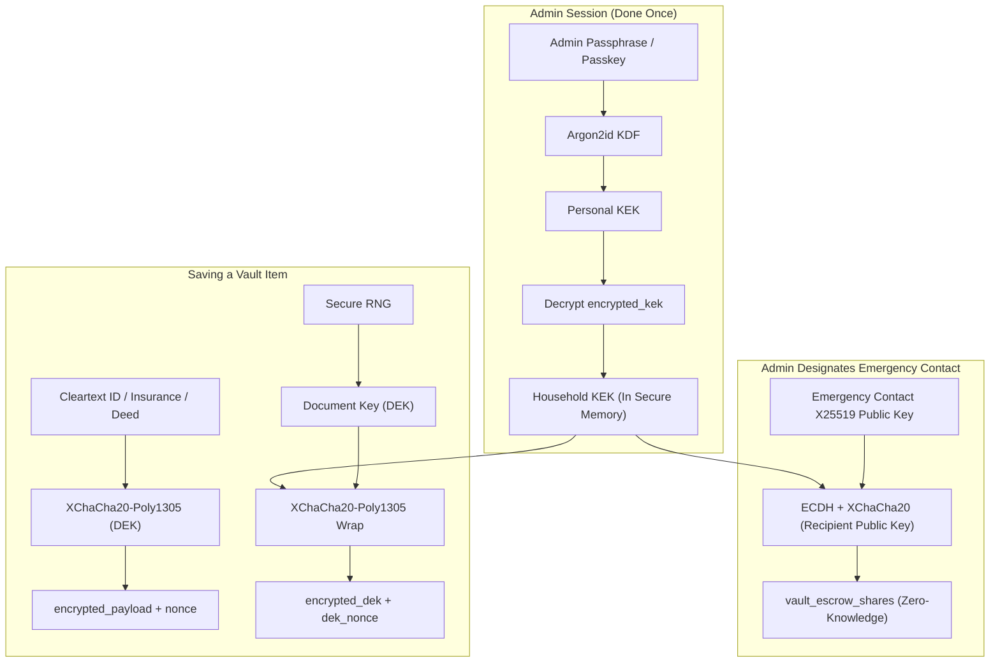
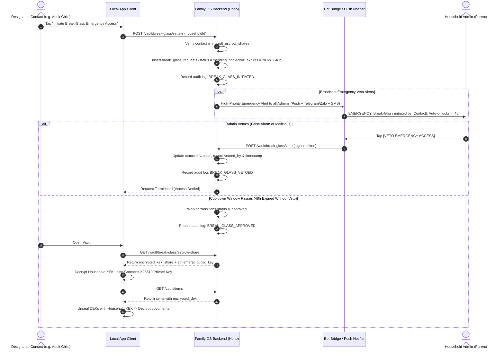
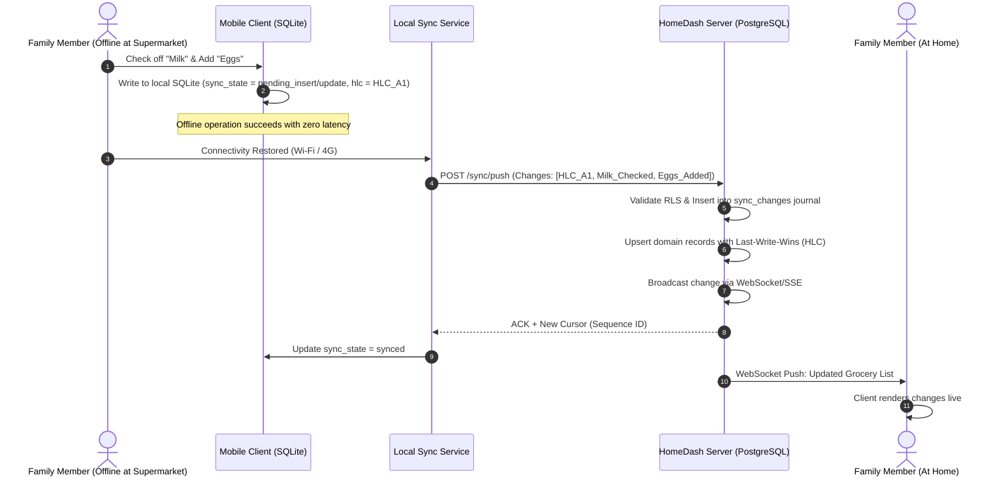

# Phase 1: System Architecture, Monorepo Blueprint & Database Schema

**Project:** Family OS (HomeDash)  
**Status:** Architecture Specification & Design Deliverable  
**Date:** 2026-11-17  
**Runtime & Toolchain:** Bun + Hono + Drizzle ORM + PostgreSQL 17 + Flutter (Material 3) + Vite (Tauri Desktop/Web)

---

## 1. Executive Architecture & Blueprint Alignment

This design adapts the **Enterprise Monorepo Architecture Blueprint** (`monorepo-architecture-blueprint.md`) for **Family OS (HomeDash)**. It organizes the codebase into a **6-tier dependency hierarchy** governed by **pnpm workspaces**, **pnpm Catalogs (`catalog:`)**, and **Turborepo**, ensuring unidirectional dependency flow, strict module isolation, local-first offline resilience, and zero version drift.

```
Downwards-Only Dependency Rule:
Tier 5 (Apps) -> Tier 4 (Domain UI & Runtime) -> Tier 3 (Adapters & Crypto) -> Tier 2 (Core Logic) -> Tier 1 (Contracts & Schemas) -> Tier 0 (Primitives)
```

### Cross-Platform Strategy (Dart / Flutter vs. TypeScript)
- **API Contracts:** Backend (Hono + Zod) in `packages/protocol` exports OpenAPI specifications. A Turborepo pipeline task (`turbo run codegen`) automatically generates type-safe Dart models and API clients for `apps/mobile` using `openapi-generator-cli` / `fdr`.
- **Cryptographic Primitives:** Both TypeScript (`packages/crypto`) and Flutter Dart consume identical standards: `Argon2id` for KDF and `XChaCha20-Poly1305` (with fallback to `AES-256-GCM`) for envelope encryption, verified against a shared cross-platform test vector fixture (`packages/shared/fixtures/crypto-vectors.json`).
- **Sync Protocol:** Server-driven Change-Data-Capture (CDC) via `sync_changes` journal, consumed via REST/WebSocket and persisted into SQLite (`drift` on Flutter, OPFS SQLite on Web).

---

## 2. Directory Taxonomy & Monorepo Layout

```
HomeDash/
├── apps/                                # Tier 5: Deployable Applications
│   ├── mobile/                          # Flutter (Dart) - iOS & Android (Strict Material 3 + Drift SQLite + Background Service)
│   ├── web/                             # Web SPA & Desktop Shell (Vite + React + Tauri Glassmorphic Bento)
│   ├── server/                          # Primary Backend API & WebSocket router (Hono + Bun + Drizzle)
│   └── android-companion/               # Headless Android listener APK for dedicated home gateway phones
│
├── packages/                            # Shared Stratified Libraries
│   ├── ui/                              # Tier 0: Headless, accessible UI primitives (Reka UI / Tailwind)
│   ├── shared/                          # Tier 0: Pure utilities, Result types, HLC (Hybrid Logical Clocks), crypto test vectors
│   ├── protocol/                        # Tier 1: Shared RPC contracts, Zod schemas, OpenAPI definitions, bot payloads
│   ├── server-schema/                   # Tier 1: PostgreSQL Drizzle ORM schemas, RLS policies, audit triggers, sync journal
│   ├── client-schema/                   # Tier 1: SQLite client schema (Drift / SQL DDL) with sync metadata
│   ├── sync-core/                       # Tier 2: Offline-first synchronization engine, change tracking, merge logic
│   ├── ai-ocr/                          # Tier 2: Pluggable utility bill parser (Ollama/Tesseract/PaddleOCR/Cloud Vision)
│   ├── crypto/                          # Tier 3: Zero-knowledge client-side encryption (Argon2id, XChaCha20-Poly1305, X25519)
│   ├── server-sdk/                      # Tier 3: Type-safe client SDK & RPC bindings for web, desktop, and bots
│   ├── server-runtime/                  # Tier 4: Reusable server middlewares (RBAC, Rate Limiting, Audit interceptor)
│   └── domain-ui/                       # Tier 4: Shared Bento widgets, Medication calendar, Grocery, Senior Mode UI
│
├── services/                            # Standalone Autonomous Daemons & Sidecars
│   ├── bot-bridge/                      # Telegram Bot & Zalo OA (Long-polling for self-host, Webhooks for cloud)
│   └── worker-ingestion/                # BullMQ queue worker: Bill OCR pipeline, medication escalation cron, sync compaction
│
├── deploy/                              # Self-Hosting & Production Orchestration
│   ├── docker-compose.yml               # Single-command self-hosted deployment (API, Postgres, Valkey, MinIO)
│   ├── docker-compose.dev.yml           # Local development infrastructure
│   └── Caddyfile                        # Reverse proxy & automated SSL
│
├── docs/                                # Project documentation & architecture specifications
├── .agents/                             # Agent skills and engineering instructions
├── pnpm-workspace.yaml                  # Central dependency catalog & workspace packages
├── turbo.json                           # Turborepo task pipelines and caching rules
└── tsconfig.json                        # Root TypeScript configuration (Bundler resolution)
```

---

## 3. Dependency Catalog & Workspace Configuration

### 3.1 `pnpm-workspace.yaml`
```yaml
catalogMode: prefer
shellEmulator: true

packages:
  - 'packages/**'
  - 'services/**'
  - 'apps/**'
  - '!**/dist/**'

catalog:
  # Backend & Core Runtime
  hono: ^4.13.9
  '@hono/zod-validator': ^0.4.3
  '@hono/openapi': ^0.4.0
  drizzle-orm: ^0.40.0
  drizzle-kit: ^0.30.5
  postgres: ^3.4.5
  bullmq: ^5.45.0
  ioredis: ^5.6.0
  zod: ^3.24.2
  
  # Frontend & Styling
  typescript: ^5.8.2
  vite: ^8.3.1
  tailwindcss: ^4.0.0
  lucide-react: ^1.16.0
  
  # Testing & Quality
  vitest: ^4.1.11
  tsdown: ^0.15.0
  oxlint: ^0.15.0
```

### 3.2 Polyglot Shims (`apps/mobile/package.json`)
Maps Flutter commands directly into Turborepo workflows:
```json
{
  "name": "@homedash/mobile",
  "version": "0.1.0",
  "private": true,
  "scripts": {
    "codegen": "openapi-generator-cli generate -i ../../packages/protocol/dist/openapi.json -g dart-dio -o ./lib/core/api",
    "build": "flutter build apk --release",
    "test": "flutter test",
    "lint": "flutter analyze"
  }
}
```

---

## 4. Normalized PostgreSQL 17+ Schema (with RLS, Audit Logs & Sync CDC)

All tables enforce multi-tenant isolation via `household_id`. PostgreSQL Row-Level Security (RLS) ensures queries cannot leak data across households or violate RBAC boundaries.

### 4.1 Schema DDL & Drizzle Definitions (`packages/server-schema`)

```sql
-- Enable necessary extensions
CREATE EXTENSION IF NOT EXISTS "uuid-ossp";
CREATE EXTENSION IF NOT EXISTS "pgcrypto";

-- Enum Definitions
CREATE TYPE user_role AS ENUM ('admin', 'senior', 'teen_child', 'caregiver_guest');
CREATE TYPE account_type AS ENUM ('shared_checking', 'personal_allowance', 'sinking_fund');
CREATE TYPE transaction_type AS ENUM ('income', 'expense', 'transfer');
CREATE TYPE transaction_source AS ENUM ('manual', 'android_push', 'bank_webhook', 'bill_ocr');
CREATE TYPE bill_type AS ENUM ('electricity', 'water', 'internet', 'mobile_plan', 'other');
CREATE TYPE bill_status AS ENUM ('detected', 'pending_review', 'approved', 'paid');
CREATE TYPE medication_status AS ENUM ('taken', 'skipped', 'snoozed', 'missed_escalated');
CREATE TYPE shift_status AS ENUM ('scheduled', 'in_progress', 'completed', 'swapped', 'cancelled');
CREATE TYPE vital_type AS ENUM ('blood_pressure', 'blood_glucose', 'heart_rate', 'temperature', 'weight');
CREATE TYPE allergy_severity AS ENUM ('mild', 'moderate', 'critical');
CREATE TYPE vault_category AS ENUM ('national_id', 'insurance', 'property_deed', 'medical_directive', 'emergency_credential');
CREATE TYPE break_glass_status AS ENUM ('pending_cooldown', 'approved', 'vetoed', 'expired');
CREATE TYPE aisle_category AS ENUM ('produce', 'dairy', 'meat_seafood', 'bakery', 'pantry', 'frozen', 'household');

-- 1. Core Multi-Tenancy & Households
CREATE TABLE households (
    id UUID PRIMARY KEY DEFAULT gen_random_uuid(),
    name VARCHAR(100) NOT NULL,
    created_at TIMESTAMPTZ NOT NULL DEFAULT NOW(),
    updated_at TIMESTAMPTZ NOT NULL DEFAULT NOW()
);

-- Module Toggles (Plug-and-play feature gating)
CREATE TABLE household_modules (
    household_id UUID PRIMARY KEY REFERENCES households(id) ON DELETE CASCADE,
    finance_enabled BOOLEAN NOT NULL DEFAULT TRUE,
    health_enabled BOOLEAN NOT NULL DEFAULT TRUE,
    vault_enabled BOOLEAN NOT NULL DEFAULT TRUE,
    daily_ops_enabled BOOLEAN NOT NULL DEFAULT TRUE,
    updated_at TIMESTAMPTZ NOT NULL DEFAULT NOW()
);

-- Users
CREATE TABLE users (
    id UUID PRIMARY KEY DEFAULT gen_random_uuid(),
    email VARCHAR(255) UNIQUE,
    phone_number VARCHAR(30) UNIQUE,
    full_name VARCHAR(120) NOT NULL,
    avatar_url TEXT,
    public_key_x25519 TEXT, -- User's public key for asymmetric envelope encryption
    created_at TIMESTAMPTZ NOT NULL DEFAULT NOW(),
    updated_at TIMESTAMPTZ NOT NULL DEFAULT NOW()
);

-- Household Membership & RBAC
CREATE TABLE household_members (
    id UUID PRIMARY KEY DEFAULT gen_random_uuid(),
    household_id UUID NOT NULL REFERENCES households(id) ON DELETE CASCADE,
    user_id UUID NOT NULL REFERENCES users(id) ON DELETE CASCADE,
    role user_role NOT NULL DEFAULT 'teen_child',
    display_name VARCHAR(80),
    is_emergency_contact BOOLEAN NOT NULL DEFAULT FALSE,
    valid_until TIMESTAMPTZ, -- Non-null for temporary Caregiver/Guest access
    created_at TIMESTAMPTZ NOT NULL DEFAULT NOW(),
    updated_at TIMESTAMPTZ NOT NULL DEFAULT NOW(),
    CONSTRAINT unique_household_user UNIQUE (household_id, user_id)
);

-- Immutable Audit Log
CREATE TABLE audit_logs (
    id UUID PRIMARY KEY DEFAULT gen_random_uuid(),
    household_id UUID NOT NULL REFERENCES households(id) ON DELETE CASCADE,
    actor_user_id UUID REFERENCES users(id) ON DELETE SET NULL,
    action VARCHAR(80) NOT NULL,
    target_resource VARCHAR(80) NOT NULL,
    target_id UUID,
    details_json JSONB NOT NULL DEFAULT '{}'::jsonb,
    ip_address INET,
    created_at TIMESTAMPTZ NOT NULL DEFAULT NOW()
);

-- Dedicated Sync Change Journal (Server-side Change Data Capture)
CREATE TABLE sync_changes (
    id BIGSERIAL PRIMARY KEY,
    household_id UUID NOT NULL REFERENCES households(id) ON DELETE CASCADE,
    entity_table VARCHAR(80) NOT NULL,
    entity_id UUID NOT NULL,
    operation VARCHAR(10) NOT NULL, -- 'INSERT', 'UPDATE', 'DELETE'
    record_payload JSONB,           -- Null on DELETE
    hlc_timestamp VARCHAR(64) NOT NULL,
    created_at TIMESTAMPTZ NOT NULL DEFAULT NOW()
);
CREATE INDEX idx_sync_changes_cursor ON sync_changes (household_id, id);

-- 2. Module A: Finance & Automated Ingestion
CREATE TABLE finance_accounts (
    id UUID PRIMARY KEY DEFAULT gen_random_uuid(),
    household_id UUID NOT NULL REFERENCES households(id) ON DELETE CASCADE,
    name VARCHAR(100) NOT NULL,
    account_type account_type NOT NULL DEFAULT 'shared_checking',
    balance_cents BIGINT NOT NULL DEFAULT 0,
    currency VARCHAR(3) NOT NULL DEFAULT 'USD',
    owner_member_id UUID REFERENCES household_members(id) ON DELETE SET NULL,
    deleted_at TIMESTAMPTZ,
    created_at TIMESTAMPTZ NOT NULL DEFAULT NOW(),
    updated_at TIMESTAMPTZ NOT NULL DEFAULT NOW()
);

CREATE TABLE finance_transactions (
    id UUID PRIMARY KEY DEFAULT gen_random_uuid(),
    household_id UUID NOT NULL REFERENCES households(id) ON DELETE CASCADE,
    account_id UUID NOT NULL REFERENCES finance_accounts(id) ON DELETE CASCADE,
    amount_cents BIGINT NOT NULL,
    transaction_type transaction_type NOT NULL,
    category VARCHAR(60) NOT NULL,
    description TEXT,
    transaction_date DATE NOT NULL DEFAULT CURRENT_DATE,
    source transaction_source NOT NULL DEFAULT 'manual',
    receipt_url TEXT,
    created_by_member_id UUID REFERENCES household_members(id) ON DELETE SET NULL,
    deleted_at TIMESTAMPTZ,
    created_at TIMESTAMPTZ NOT NULL DEFAULT NOW(),
    updated_at TIMESTAMPTZ NOT NULL DEFAULT NOW()
);

CREATE TABLE utility_bills (
    id UUID PRIMARY KEY DEFAULT gen_random_uuid(),
    household_id UUID NOT NULL REFERENCES households(id) ON DELETE CASCADE,
    provider_name VARCHAR(120) NOT NULL,
    bill_type bill_type NOT NULL,
    billing_period_start DATE,
    billing_period_end DATE,
    amount_cents BIGINT NOT NULL,
    due_date DATE NOT NULL,
    status bill_status NOT NULL DEFAULT 'detected',
    raw_invoice_url TEXT,
    ocr_metadata JSONB DEFAULT '{}'::jsonb,
    deleted_at TIMESTAMPTZ,
    created_at TIMESTAMPTZ NOT NULL DEFAULT NOW(),
    updated_at TIMESTAMPTZ NOT NULL DEFAULT NOW()
);

-- 3. Module B: Multi-Generational Health & Care Hub
CREATE TABLE medications (
    id UUID PRIMARY KEY DEFAULT gen_random_uuid(),
    household_id UUID NOT NULL REFERENCES households(id) ON DELETE CASCADE,
    patient_member_id UUID NOT NULL REFERENCES household_members(id) ON DELETE CASCADE,
    name VARCHAR(120) NOT NULL,
    dosage VARCHAR(80) NOT NULL,
    instructions TEXT,
    schedule_cron VARCHAR(50) NOT NULL, -- e.g., '0 8 * * *' (Every day at 8:00 AM)
    remaining_pills INT NOT NULL DEFAULT 0,
    refill_threshold INT NOT NULL DEFAULT 5,
    is_active BOOLEAN NOT NULL DEFAULT TRUE,
    deleted_at TIMESTAMPTZ,
    created_at TIMESTAMPTZ NOT NULL DEFAULT NOW(),
    updated_at TIMESTAMPTZ NOT NULL DEFAULT NOW()
);

CREATE TABLE medication_logs (
    id UUID PRIMARY KEY DEFAULT gen_random_uuid(),
    household_id UUID NOT NULL REFERENCES households(id) ON DELETE CASCADE,
    medication_id UUID NOT NULL REFERENCES medications(id) ON DELETE CASCADE,
    scheduled_at TIMESTAMPTZ NOT NULL,
    taken_at TIMESTAMPTZ,
    status medication_status NOT NULL DEFAULT 'taken',
    photo_proof_url TEXT,
    recorded_by_member_id UUID REFERENCES household_members(id) ON DELETE SET NULL,
    deleted_at TIMESTAMPTZ,
    created_at TIMESTAMPTZ NOT NULL DEFAULT NOW()
);

CREATE TABLE caregiver_shifts (
    id UUID PRIMARY KEY DEFAULT gen_random_uuid(),
    household_id UUID NOT NULL REFERENCES households(id) ON DELETE CASCADE,
    patient_member_id UUID NOT NULL REFERENCES household_members(id) ON DELETE CASCADE,
    assigned_member_id UUID NOT NULL REFERENCES household_members(id) ON DELETE CASCADE,
    start_time TIMESTAMPTZ NOT NULL,
    end_time TIMESTAMPTZ NOT NULL,
    status shift_status NOT NULL DEFAULT 'scheduled',
    notes TEXT,
    deleted_at TIMESTAMPTZ,
    created_at TIMESTAMPTZ NOT NULL DEFAULT NOW(),
    updated_at TIMESTAMPTZ NOT NULL DEFAULT NOW()
);

CREATE TABLE vitals_logs (
    id UUID PRIMARY KEY DEFAULT gen_random_uuid(),
    household_id UUID NOT NULL REFERENCES households(id) ON DELETE CASCADE,
    member_id UUID NOT NULL REFERENCES household_members(id) ON DELETE CASCADE,
    vital_type vital_type NOT NULL,
    value_primary NUMERIC(6, 2) NOT NULL,
    value_secondary NUMERIC(6, 2),
    unit VARCHAR(20) NOT NULL,
    recorded_at TIMESTAMPTZ NOT NULL DEFAULT NOW(),
    notes TEXT,
    deleted_at TIMESTAMPTZ,
    created_at TIMESTAMPTZ NOT NULL DEFAULT NOW()
);

CREATE TABLE medical_allergies (
    id UUID PRIMARY KEY DEFAULT gen_random_uuid(),
    household_id UUID NOT NULL REFERENCES households(id) ON DELETE CASCADE,
    member_id UUID NOT NULL REFERENCES household_members(id) ON DELETE CASCADE,
    allergen VARCHAR(100) NOT NULL,
    severity allergy_severity NOT NULL DEFAULT 'critical',
    reaction_description TEXT,
    deleted_at TIMESTAMPTZ,
    created_at TIMESTAMPTZ NOT NULL DEFAULT NOW()
);

-- 4. Module C: Zero-Knowledge Vault & Lifecycle

-- Master Key Encryption Key (KEK) encrypted per admin user
CREATE TABLE household_vault_keys (
    id UUID PRIMARY KEY DEFAULT gen_random_uuid(),
    household_id UUID NOT NULL REFERENCES households(id) ON DELETE CASCADE,
    user_id UUID NOT NULL REFERENCES users(id) ON DELETE CASCADE,
    encrypted_kek TEXT NOT NULL,       -- KEK encrypted with user's personal credential/passkey
    kek_salt VARCHAR(64) NOT NULL,     -- Salt for personal KDF
    kek_nonce VARCHAR(64) NOT NULL,
    created_at TIMESTAMPTZ NOT NULL DEFAULT NOW(),
    updated_at TIMESTAMPTZ NOT NULL DEFAULT NOW(),
    CONSTRAINT unique_vault_key UNIQUE (household_id, user_id)
);

CREATE TABLE vault_items (
    id UUID PRIMARY KEY DEFAULT gen_random_uuid(),
    household_id UUID NOT NULL REFERENCES households(id) ON DELETE CASCADE,
    title VARCHAR(150) NOT NULL,
    category vault_category NOT NULL,
    encrypted_payload TEXT NOT NULL,   -- Base64 ciphertext encrypted with DEK
    payload_nonce VARCHAR(64) NOT NULL,-- IV for payload
    encrypted_dek TEXT NOT NULL,       -- DEK wrapped with household KEK
    dek_nonce VARCHAR(64) NOT NULL,    -- IV for wrapped DEK
    key_version INT NOT NULL DEFAULT 1,
    created_by_member_id UUID REFERENCES household_members(id) ON DELETE SET NULL,
    deleted_at TIMESTAMPTZ,
    created_at TIMESTAMPTZ NOT NULL DEFAULT NOW(),
    updated_at TIMESTAMPTZ NOT NULL DEFAULT NOW()
);

-- Pre-provisioned Escrow Shares for Emergency Contacts
CREATE TABLE vault_escrow_shares (
    id UUID PRIMARY KEY DEFAULT gen_random_uuid(),
    household_id UUID NOT NULL REFERENCES households(id) ON DELETE CASCADE,
    recipient_user_id UUID NOT NULL REFERENCES users(id) ON DELETE CASCADE,
    encrypted_kek_share TEXT NOT NULL, -- KEK encrypted under recipient's public key (X25519)
    ephemeral_public_key TEXT NOT NULL,-- Ephemeral public key used for ECDH
    nonce VARCHAR(64) NOT NULL,
    created_at TIMESTAMPTZ NOT NULL DEFAULT NOW(),
    updated_at TIMESTAMPTZ NOT NULL DEFAULT NOW(),
    CONSTRAINT unique_escrow_share UNIQUE (household_id, recipient_user_id)
);

CREATE TABLE break_glass_requests (
    id UUID PRIMARY KEY DEFAULT gen_random_uuid(),
    household_id UUID NOT NULL REFERENCES households(id) ON DELETE CASCADE,
    requester_user_id UUID NOT NULL REFERENCES users(id) ON DELETE CASCADE,
    status break_glass_status NOT NULL DEFAULT 'pending_cooldown',
    cooldown_expires_at TIMESTAMPTZ NOT NULL, -- Cooldown: 24 to 48 hours
    vetoed_by_user_id UUID REFERENCES users(id),
    vetoed_at TIMESTAMPTZ,
    released_at TIMESTAMPTZ,
    created_at TIMESTAMPTZ NOT NULL DEFAULT NOW()
);

CREATE TABLE asset_renewals (
    id UUID PRIMARY KEY DEFAULT gen_random_uuid(),
    household_id UUID NOT NULL REFERENCES households(id) ON DELETE CASCADE,
    title VARCHAR(120) NOT NULL,
    category VARCHAR(60) NOT NULL,
    due_date DATE NOT NULL,
    reminder_days_before INT[] DEFAULT '{30, 7, 1}',
    last_notified_at TIMESTAMPTZ,
    deleted_at TIMESTAMPTZ,
    created_at TIMESTAMPTZ NOT NULL DEFAULT NOW(),
    updated_at TIMESTAMPTZ NOT NULL DEFAULT NOW()
);

CREATE TABLE home_wiki_cards (
    id UUID PRIMARY KEY DEFAULT gen_random_uuid(),
    household_id UUID NOT NULL REFERENCES households(id) ON DELETE CASCADE,
    title VARCHAR(120) NOT NULL,
    category VARCHAR(60) NOT NULL,
    content_markdown TEXT NOT NULL,
    metadata JSONB DEFAULT '{}'::jsonb,
    deleted_at TIMESTAMPTZ,
    created_at TIMESTAMPTZ NOT NULL DEFAULT NOW(),
    updated_at TIMESTAMPTZ NOT NULL DEFAULT NOW()
);

-- 5. Module D: Daily Household Operations
CREATE TABLE grocery_items (
    id UUID PRIMARY KEY DEFAULT gen_random_uuid(),
    household_id UUID NOT NULL REFERENCES households(id) ON DELETE CASCADE,
    name VARCHAR(120) NOT NULL,
    quantity VARCHAR(50) DEFAULT '1',
    aisle_category aisle_category NOT NULL DEFAULT 'pantry',
    is_checked BOOLEAN NOT NULL DEFAULT FALSE,
    checked_by_member_id UUID REFERENCES household_members(id),
    checked_at TIMESTAMPTZ,
    deleted_at TIMESTAMPTZ,
    created_at TIMESTAMPTZ NOT NULL DEFAULT NOW(),
    updated_at TIMESTAMPTZ NOT NULL DEFAULT NOW()
);

CREATE TABLE meal_plans (
    id UUID PRIMARY KEY DEFAULT gen_random_uuid(),
    household_id UUID NOT NULL REFERENCES households(id) ON DELETE CASCADE,
    planned_date DATE NOT NULL,
    meal_type VARCHAR(20) NOT NULL,
    recipe_title VARCHAR(120) NOT NULL,
    notes TEXT,
    deleted_at TIMESTAMPTZ,
    created_at TIMESTAMPTZ NOT NULL DEFAULT NOW(),
    updated_at TIMESTAMPTZ NOT NULL DEFAULT NOW()
);

CREATE TABLE chores (
    id UUID PRIMARY KEY DEFAULT gen_random_uuid(),
    household_id UUID NOT NULL REFERENCES households(id) ON DELETE CASCADE,
    title VARCHAR(120) NOT NULL,
    assigned_member_id UUID REFERENCES household_members(id) ON DELETE SET NULL,
    recurrence_rule VARCHAR(50),
    reward_points INT NOT NULL DEFAULT 0,
    allowance_cents BIGINT NOT NULL DEFAULT 0,
    is_completed BOOLEAN NOT NULL DEFAULT FALSE,
    verified_by_admin BOOLEAN NOT NULL DEFAULT FALSE,
    deleted_at TIMESTAMPTZ,
    created_at TIMESTAMPTZ NOT NULL DEFAULT NOW(),
    updated_at TIMESTAMPTZ NOT NULL DEFAULT NOW()
);
```

### 4.2 Row-Level Security (RLS) Implementation
The backend establishes request context via session variables: `app.current_household_id`, `app.current_user_id`, and `app.current_user_role`.

```sql
-- Enable RLS on core tables
ALTER TABLE finance_accounts ENABLE ROW LEVEL SECURITY;
ALTER TABLE finance_transactions ENABLE ROW LEVEL SECURITY;
ALTER TABLE vault_items ENABLE ROW LEVEL SECURITY;
ALTER TABLE vault_escrow_shares ENABLE ROW LEVEL SECURITY;
ALTER TABLE medication_logs ENABLE ROW LEVEL SECURITY;

-- 1. Multi-Tenant Isolation
CREATE POLICY household_tenant_isolation ON finance_accounts
    FOR ALL
    USING (household_id = NULLIF(current_setting('app.current_household_id', true), '')::UUID);

-- 2. Role-Based Access for Vault (Admin only; Caregivers & Children have zero access)
CREATE POLICY vault_admin_access ON vault_items
    FOR ALL
    USING (
        household_id = NULLIF(current_setting('app.current_household_id', true), '')::UUID
        AND current_setting('app.current_user_role', true) = 'admin'
    );

-- 3. Escrow Shares Access (Only recipient during approved break-glass, or admin for management)
CREATE POLICY vault_escrow_access ON vault_escrow_shares
    FOR SELECT
    USING (
        household_id = NULLIF(current_setting('app.current_household_id', true), '')::UUID
        AND (
            current_setting('app.current_user_role', true) = 'admin'
            OR (
                recipient_user_id = NULLIF(current_setting('app.current_user_id', true), '')::UUID
                AND EXISTS (
                    SELECT 1 FROM break_glass_requests bgr 
                    WHERE bgr.household_id = vault_escrow_shares.household_id 
                      AND bgr.requester_user_id = vault_escrow_shares.recipient_user_id 
                      AND bgr.status = 'approved'
                )
            )
        )
    );

-- 4. Caregiver Scoped Access (Caregiver can view & insert medication logs)
CREATE POLICY medication_caregiver_access ON medication_logs
    FOR SELECT
    USING (
        household_id = NULLIF(current_setting('app.current_household_id', true), '')::UUID
        AND current_setting('app.current_user_role', true) IN ('admin', 'senior', 'caregiver_guest')
    );

CREATE POLICY medication_caregiver_insert ON medication_logs
    FOR INSERT
    WITH CHECK (
        household_id = NULLIF(current_setting('app.current_household_id', true), '')::UUID
        AND current_setting('app.current_user_role', true) IN ('admin', 'senior', 'caregiver_guest')
    );
```

---

## 5. Local SQLite Client Sync Schema (`packages/client-schema`)

Client devices mirror the server schema with local-first sync metadata columns:
- `sync_state`: `0 = synced`, `1 = pending_insert`, `2 = pending_update`, `3 = pending_delete`
- `hlc_timestamp`: Hybrid Logical Clock string (e.g. `2026-11-17T11:50:00.000Z-0001-deviceA`)
- `is_deleted`: Soft-delete flag for tombstone propagation

```sql
CREATE TABLE local_medication_logs (
    id TEXT PRIMARY KEY NOT NULL,
    household_id TEXT NOT NULL,
    medication_id TEXT NOT NULL,
    scheduled_at TEXT NOT NULL,
    taken_at TEXT,
    status TEXT NOT NULL,
    photo_proof_path TEXT,
    recorded_by_member_id TEXT,
    -- Local-first sync tracking columns
    sync_state INTEGER NOT NULL DEFAULT 1,
    hlc_timestamp TEXT NOT NULL,
    is_deleted INTEGER NOT NULL DEFAULT 0,
    created_at TEXT NOT NULL,
    updated_at TEXT NOT NULL
);

CREATE TABLE local_grocery_items (
    id TEXT PRIMARY KEY NOT NULL,
    household_id TEXT NOT NULL,
    name TEXT NOT NULL,
    quantity TEXT NOT NULL DEFAULT '1',
    aisle_category TEXT NOT NULL,
    is_checked INTEGER NOT NULL DEFAULT 0,
    checked_by_member_id TEXT,
    checked_at TEXT,
    -- Local-first sync tracking columns
    sync_state INTEGER NOT NULL DEFAULT 1,
    hlc_timestamp TEXT NOT NULL,
    is_deleted INTEGER NOT NULL DEFAULT 0,
    created_at TEXT NOT NULL,
    updated_at TEXT NOT NULL
);
```

---

## 6. Cryptographic Architecture: E2EE Vault & Break-Glass Protocol

### 6.1 Cryptographic Primitives & Envelope Encryption
1. **User Personal KDF:** `Argon2id` derives personal Key Encryption Key ($KEK_{user}$) from passphrase/passkey. Derived **once per session** and kept in secure memory.
2. **Household Master Key:** A shared 256-bit symmetric key ($KEK_{household}$) is stored encrypted per admin in `household_vault_keys`.
3. **Item Encryption:** Each document/card has a cryptographically random 256-bit Document Encryption Key (DEK). The cleartext payload is encrypted with `XChaCha20-Poly1305` using the DEK. The DEK is then wrapped by $KEK_{household}$.
4. **Emergency Escrow Shares:** When an admin designates an emergency contact, the admin's client encrypts $KEK_{household}$ with the recipient's public key ($X25519_{contact}$) via ECDH + `XChaCha20-Poly1305`, saving it to `vault_escrow_shares`. The server **never** sees or holds the raw key.



### 6.2 Break-Glass Emergency Access Sequence Diagram
Guarantees Zero-Knowledge emergency access with an enforceable 24-48 hour timelock cooldown and admin veto.



### 6.3 Local-First Conflict-Free Synchronization Flow



---

## 7. Deliverables Checklist & Next Actions

- [x] **Monorepo Blueprint Alignment**: 6-Tier architecture implemented with pnpm catalogs, Turborepo, and OpenAPI Dart code generation.
- [x] **PostgreSQL 17+ Normalized Schema**: Multi-tenant DDL with `household_id`, RBAC roles, audit logs, module toggles, soft deletes, and `sync_changes` CDC journal.
- [x] **PostgreSQL RLS Policies**: Row-level policies for tenant isolation, vault admin-only access, caregiver-scoped logging, and break-glass escrow release.
- [x] **Client SQLite Schema**: Offline-first sync schema with HLC timestamps and sync state flags.
- [x] **Cryptographic Sequence Diagrams**: Complete workflows for Zero-Knowledge envelope encryption, 48-hour Break-Glass asymmetric emergency escrow, and offline-first synchronization.

This completes **Phase 1** specifications. Ready for your review and approval!
