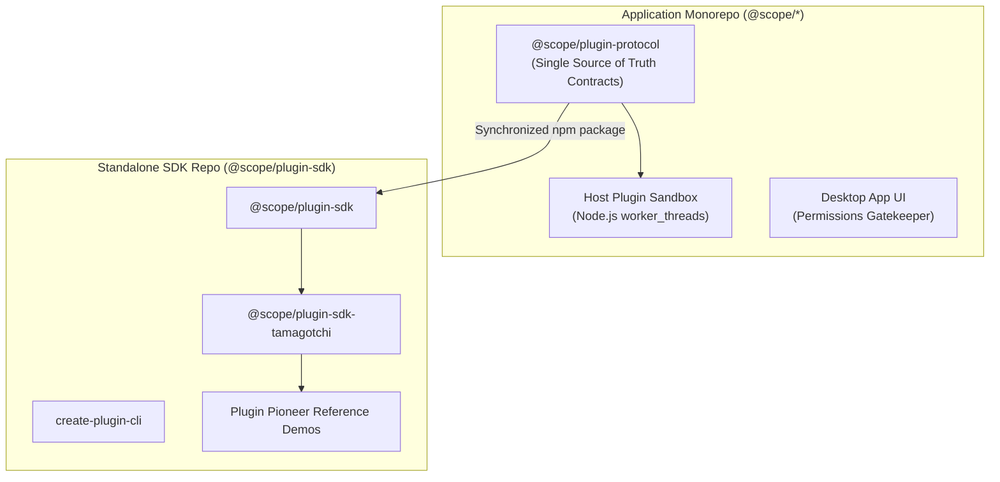

# Enterprise Monorepo Architecture Blueprint
## A Reference Guide for Multi-Platform, Multi-Package Codebases

> **Document Type**: Architecture Specification & Monorepo Blueprint  
> **Source Model**: Project NekoAI Monorepo Layout & Engineering Directives  
> **Target Audience**: Technical Architects, Lead Engineers, and Platform Engineering Teams  
> **Applicability**: Multi-platform client applications (Desktop, Web, Mobile), shared design systems, microservices/daemons, and polyglot runtimes.

---

## 1. Executive Summary & Core Design Philosophy

Managing a product ecosystem spanning desktop, web, mobile, backend services, AI agents, and extensible plugins within separate repositories leads to severe dependency drift, duplicated business logic, fragile integration boundaries, and high release coordination friction.

This document formalizes the **Tiered Monorepo Architecture** proven in the Project NekoAI codebase. It provides a concrete blueprint for organizing a unified repository using **pnpm workspaces**, **pnpm Catalogs**, **Turborepo**, **TypeScript Bundler resolution**, **contract-first IPC/RPC (`@moeru/eventa`)**, and a **5-tier dependency hierarchy**.

### Core Architecture Axioms

1. **Strict Dependency Stratification (Unidirectional Flow)**: Code only depends downwards. Foundation primitives never import business logic; domain libraries never import deployable shells; deployable apps never import sibling apps.
2. **Contract-First System Boundaries**: Cross-process communication (IPC), cross-thread workers, WebSockets, and plugins communicate exclusively through typed contracts and schemas (`@moeru/eventa` and `valibot`), eliminating untyped messaging and manual synchronization.
3. **Dual UI Layering (Headless Primitives vs. Domain Composables)**:
   - **Base Primitives (`@scope/ui`)**: Completely headless, accessible, and stateless component primitives (built on `reka-ui`). Contains zero business logic.
   - **Domain UI (`@scope/domain-ui`)**: Domain-specific Pinia stores, composables, scenario widgets, and orchestration flows that assemble base primitives.
4. **Centralized Dependency Cataloging (`pnpm catalog:`)**: All external dependency versions are centrally governed in `pnpm-workspace.yaml`. Individual `package.json` files declare `"catalog:"`, eliminating version divergence across dozens of packages.
5. **Polyglot Substrate Harmonization**: Non-JavaScript runtimes (e.g., Godot C#, Rust native modules, Python ML daemons) are wrapped in thin `package.json` shims so they participate seamlessly in Turborepo and pnpm workspace workflows.
6. **Application Monorepo vs. Standalone Developer SDK Separation**: The main monorepo owns runtime execution, host security gatekeepers, and core services. Third-party developer tools and SDKs live in a separate standalone repository to maintain clean licensing and isolated release lifecycles, synchronized via a single-source-of-truth protocol package.

---

## 2. Directory Taxonomy & Workspace Layout

A well-structured monorepo separates targets by their operational role: **deployable applications**, **shared libraries**, **standalone background services**, **pluggable extensions**, **polyglot engines**, and **developer tooling**.

```
/
├── apps/                 # Deployable target applications (end-user shells)
│   ├── stage-tamagotchi/ # Desktop client (Electron + Vue 3)
│   ├── stage-web/        # Web client SPA (Vite + Vue 3)
│   ├── stage-pocket/     # Mobile client (Capacitor 8 for iOS/Android)
│   ├── server/           # Backend API & WebSocket router (Hono + Node.js)
│   └── ui-server-auth/   # Standalone account & authentication portal
│
├── packages/             # Shared internal libraries (stratified into tiers)
│   ├── ui/               # Headless, accessible UI primitives (Reka UI based)
│   ├── stage-ui/         # Core business components, Pinia stores, composables
│   ├── stage-layouts/    # High-level responsive UI shells & layout slots
│   ├── stage-pages/      # Common route page definitions across platforms
│   ├── stage-shared/     # Platform detection, shared telemetry, utilities
│   ├── core-agent/       # AI chat orchestrator, LLM streaming, tools runtime
│   ├── plugin-protocol/  # Single source of truth: typed event contracts & schemas
│   ├── server-schema/    # Database & Drizzle schemas, RPC contracts
│   ├── server-runtime/   # Reusable WebSocket & server engine middleware
│   ├── server-sdk/       # Client SDK for apps and bots to connect to server
│   ├── electron-eventa/  # Typed Electron IPC bridge contracts
│   ├── i18n/             # Centralized localization catalogs
│   ├── memory-core/      # Memory interfaces, vector scoring, deduplication
│   ├── memory-pgvector/  # Vector storage & encryption adapters
│   ├── audio/            # Low-level audio processing & WebAudio graphs
│   ├── pipelines-audio/  # VAD, Kokoro TTS, & Whisper transcription pipelines
│   └── unocss-preset-*/  # Shared styling presets, typography, & tokens
│
├── services/             # Autonomous background services & daemon sidecars
│   ├── computer-use-mcp/ # Desktop automation MCP server (Win32/Accessibility/CDP)
│   ├── discord-bot/      # Standalone Discord gateway adapter
│   ├── telegram-bot/     # Standalone Telegram gateway adapter
│   └── minecraft/        # Game bridge bot & protocol adapter
│
├── plugins/              # Pluggable user-space extensions (isolated workers)
│   ├── plugin-web-extension/ # Browser companion extension
│   ├── plugin-game-chess/    # Modular mini-game runtime
│   └── plugin-homeassistant/ # IoT orchestration extension
│
├── engines/              # Polyglot rendering & game engines
│   └── stage-tamagotchi-godot/ # Godot C# native 3D engine workspace
│
├── integrations/         # Third-party IDE & editor extensions
│   └── vscode/           # VS Code assistant companion extension
│
├── docs/                 # Documentation portal (VitePress)
├── agentdocs/            # Technical research, architecture audits, & design specs
├── patches/              # pnpm patchedDependencies for upstream fixes
├── scripts/              # Monorepo build, signing, and release automation
├── .agents/              # AI coding agent skills, system prompts, & rules
├── pnpm-workspace.yaml   # Workspace package globs & centralized dependency catalogs
├── turbo.json            # Turborepo task dependencies & cache rules
└── tsconfig.json         # Base TypeScript configuration (Bundler resolution)
```

---

## 3. Package Stratification & Dependency Flow Graph

To prevent circular dependencies and "spaghetti imports", all packages and applications are organized into **6 strict architectural tiers**.

### The 6-Tier Architecture

```mermaid
flowchart TD
    subgraph T5["Tier 5: Deployable Applications (apps/*)"]
        AppDesktop["apps/stage-tamagotchi (Electron)"]
        AppWeb["apps/stage-web (Vite SPA)"]
        AppMobile["apps/stage-pocket (Capacitor)"]
        AppServer["apps/server (Hono Backend)"]
    end

    subgraph T4["Tier 4: Business UI & High-Level Shells"]
        StageUI["packages/stage-ui"]
        StageLayouts["packages/stage-layouts"]
        StagePages["packages/stage-pages"]
        ServerRuntime["packages/server-runtime"]
    end

    subgraph T3["Tier 3: Platform Adapters & Specialized Runtimes"]
        UIThree["packages/stage-ui-three"]
        UILive2D["packages/stage-ui-live2d"]
        MemPgvector["packages/memory-pgvector"]
        AudioPipelines["packages/pipelines-audio"]
        ElectronEventa["packages/electron-eventa"]
        ServerSDK["packages/server-sdk"]
    end

    subgraph T2["Tier 2: Core Domain Logic & AI Runtimes"]
        CoreAgent["packages/core-agent"]
        BetterWS["packages/better-ws"]
        MemCore["packages/memory-core"]
        AudioCore["packages/audio"]
    end

    subgraph T1["Tier 1: Protocol, Contracts & Shared Schemas"]
        PluginProtocol["packages/plugin-protocol"]
        ServerSchema["packages/server-schema"]
        ServerShared["packages/server-shared"]
    end

    subgraph T0["Tier 0: Foundation & Headless Primitives"]
        UIPrimitives["packages/ui (Reka UI Primitives)"]
        StdLib["@moeru/std (Error, Types, Functional)"]
        I18n["packages/i18n"]
        StageShared["packages/stage-shared"]
        Eventa["@moeru/eventa (IPC/RPC Library)"]
    end

    AppDesktop --> StageUI
    AppDesktop --> StageLayouts
    AppDesktop --> ElectronEventa
    AppWeb --> StageUI
    AppWeb --> StageLayouts
    AppWeb --> UIThree
    AppMobile --> StageUI
    AppServer --> ServerRuntime
    AppServer --> ServerSchema

    StageUI --> UIPrimitives
    StageUI --> CoreAgent
    StageUI --> PluginProtocol
    StageUI --> StageShared
    StageUI --> I18n

    StageLayouts --> UIPrimitives
    StageLayouts --> StageShared

    CoreAgent --> PluginProtocol
    CoreAgent --> BetterWS
    CoreAgent --> MemCore

    MemPgvector --> MemCore
    AudioPipelines --> AudioCore

    PluginProtocol --> Eventa
    PluginProtocol --> StdLib
    ServerSchema --> StdLib
```



### Dependency Invariants & Architectural Rules

| Rule | Description | Violation Consequence |
|---|---|---|
| **Downwards Only** | A package in Tier $N$ may only import from Tier $N-1$ down to Tier $0$. | Circular dependency deadlocks, build pipeline failures. |
| **No Sibling App Imports** | `apps/stage-tamagotchi` can NEVER import from `apps/stage-web` or `apps/server`. | Tightly coupled build trees, leaky environment assumptions (Node vs. Browser). |
| **Stateless Primitives** | `packages/ui` must NEVER import Pinia stores, business schemas, or platform APIs. | Prevents reusing buttons and inputs across headless contexts and stories. |
| **Contract Independence** | `packages/plugin-protocol` must have minimal runtime dependencies (`@moeru/eventa`, `valibot`). | Allows external plugin authors to install the protocol without pulling entire app bundles. |
| **No Backward Compatibility Shims** | Do not write backwards-compatibility shim layers inside shared packages. Refactor callers atomically. | Codebase bloat, silent dead branches, unmaintainable divergence. |

---

## 4. Workspace Toolchain & Build System

### 4.1. Workspace Definition & Central Catalogs (`pnpm-workspace.yaml`)

A major hazard in large monorepos is **dependency drift**—where different packages import different minor versions of `vue`, `vite`, `typescript`, or `lodash`, triggering duplicate bundle chunks, symbol collision, and phantom type mismatches.

The architecture solves this via **pnpm Catalogs** (`catalog:`):

```yaml
# pnpm-workspace.yaml
catalogMode: prefer
shellEmulator: true

packages:
  - 'packages/**'
  - 'plugins/**'
  - 'integrations/**'
  - 'services/**'
  - 'engines/**'
  - 'apps/**'
  - '!**/dist/**'

# Centralized dependency catalog (single source of truth for versions)
catalog:
  vue: 3.5.32
  vite: ^8.3.1
  typescript: ^5.8.2
  electron: ^41.10.7
  hono: ^4.13.9
  reka-ui: ^2.0.0
  pinia: ^3.0.1
  '@vueuse/core': ^12.8.2
  '@moeru/eventa': ^0.4.1
  '@moeru/std': ^0.2.2
  valibot: ^1.0.0
  vitest: ^4.1.11
  tsdown: ^0.15.0

# Dedicated named catalogs for specialized groups
catalogs:
  vitest:
    '@vitest/browser': ^4.1.11
    '@vitest/browser-playwright': ^4.1.11
    '@vitest/coverage-v8': ^4.1.11

# Targeted overrides to enforce security and nolyfill optimizations
overrides:
  axios: npm:feaxios@^0.0.23
  array-flatten: npm:@nolyfill/array-flatten@^1.0.44

# Upstream patches maintained cleanly in-repo
patchedDependencies:
  '@mediapipe/tasks-vision': patches/@mediapipe__tasks-vision.patch
  '@xsai/stream-text@0.5.0-beta.2': patches/@xsai__stream-text@0.5.0-beta.2.patch
```

#### Consuming Dependencies in Packages

Inside any internal package (e.g., `packages/stage-ui/package.json`), dependencies reference the catalog and internal packages using the `workspace:^` protocol:

```json
{
  "name": "@scope/stage-ui",
  "dependencies": {
    "vue": "catalog:",
    "@moeru/eventa": "catalog:",
    "@scope/ui": "workspace:^",
    "@scope/core-agent": "workspace:^",
    "@scope/plugin-protocol": "workspace:^"
  },
  "devDependencies": {
    "typescript": "catalog:",
    "vue-tsc": "catalog:"
  }
}
```

### 4.2. Build Pipeline Orchestration (`turbo.json`)

Turborepo coordinates build execution order based on the dependency graph, providing topological scheduling, parallel execution, and aggressive caching of build artifacts:

```json
{
  "$schema": "https://turborepo.com/schema.json",
  "tasks": {
    "build": {
      "dependsOn": ["^build"],
      "outputs": ["dist/**"]
    },
    "@scope/server-schema#build": {
      "cache": false
    },
    "@scope/electron-vueuse#build": {
      "dependsOn": ["@scope/electron-eventa#build"],
      "outputs": ["dist/**"]
    }
  }
}
```

### 4.3. Dual Bundling Strategy: Applications vs. Libraries

| Category | Tool | Strategy | Rationale |
|---|---|---|---|
| **Deployable Apps** (`apps/*`) | **Vite / electron-vite** | Direct ESM bundling from source files | Fast HMR during development; tree-shaken, optimized production bundles without intermediate compilation steps. |
| **Shared Core Libraries** (`packages/core-*`, `packages/plugin-*`) | **tsdown** (Rollup + esbuild + oxc) | Compiles TypeScript source into `dist/index.mjs` and `dist/index.d.mts` | Fast compilation generating standard dual ESM/TypeScript definition files; enables non-Vite consumers and external consumers to use the packages. |
| **Internal UI Components** (`packages/stage-ui`, `packages/ui`) | **Zero-Build (Direct Source)** | Vite consumes raw `.vue` and `.ts` directly via workspace resolution | Eliminates build latency; allows instant HMR across the entire monorepo when editing components. |

### 4.4. Fine-Grained Subpath Exports Map

Internal packages avoid giant monolithic barrel files (`index.ts` exporting 500 symbols). Instead, they declare explicit subpath exports in `package.json`, which prevents circular dependencies, optimizes tree-shaking, and clarifies boundaries:

```json
{
  "name": "@scope/stage-ui",
  "exports": {
    ".": "./src/index.ts",
    "./components/scenarios/chat": "./src/components/scenarios/chat/index.ts",
    "./components/*": "./src/components/*.ts",
    "./composables/*": "./src/composables/*.ts",
    "./stores/*": "./src/stores/*.ts",
    "./types/*": "./src/types/*.ts"
  }
}
```

---

## 5. Cross-Process Communication (IPC) & Event Contracts

In desktop (Electron) and multi-threaded (Web Worker / Node Worker) architectures, raw untyped channels (e.g. `ipcRenderer.send('msg', data)`) lead to runtime crashes and breaking changes.

This architecture standardizes on **`@moeru/eventa`**—a transport-agnostic, type-safe event and RPC layer.

### 5.1. Defining Contracts Centrally (`shared/contracts.ts`)

Contracts are defined in neutral packages or shared folders accessible to both the caller and the listener:

```ts
import { defineEventa, defineInvokeEventa } from '@moeru/eventa'

// 1. One-way asynchronous notifications
export const windowMinimizeEvent = defineEventa<{ windowId: string }>('window:minimize')

// 2. Request/Response RPC invocation
export const captureScreenInvoke = defineInvokeEventa<
  { displayId: string; quality: number }, // Request Payload
  { base64Data: string; width: number; height: number } // Response Payload
>('screen:capture')
```

### 5.2. Implementing the Host / Main Process Service

The host process uses functional Dependency Injection (`injeca`) and binds to the contract using context adapters:

```ts
import { provide } from 'injeca'
import { captureScreenInvoke } from '@scope/shared/contracts'
import { onInvoke } from '@moeru/eventa'
import { electronMainContext } from '@scope/electron-eventa'

export function registerScreenService() {
  const context = electronMainContext()

  onInvoke(context, captureScreenInvoke, async ({ displayId, quality }) => {
    // Business logic runs safely in Node/Electron main process
    const buffer = await nativeCapture(displayId, quality)
    return {
      base64Data: buffer.toString('base64'),
      width: 1920,
      height: 1080,
    }
  })
}
```

### 5.3. Calling from the Client / Renderer Process

The renderer calls the RPC method with compile-time type safety:

```ts
import { invoke } from '@moeru/eventa'
import { electronRendererContext } from '@scope/electron-eventa'
import { captureScreenInvoke } from '@scope/shared/contracts'

const context = electronRendererContext()

// Fully typed arguments and return types
const result = await invoke(context, captureScreenInvoke, {
  displayId: 'primary',
  quality: 85,
})
console.log(result.width, result.height)
```

---

## 6. UI & Design System Architecture

```mermaid
flowchart LR
    subgraph Layer0["Headless Primitives (@scope/ui)"]
        BaseButton["Button (Reka UI)"]
        BaseInput["Input / Form"]
        BaseDialog["Dialog / Modal"]
        BaseDropdown["Dropdown Menu"]
    end

    subgraph Layer1["Domain Business UI (@scope/stage-ui)"]
        ChatArea["ChatArea Scenario"]
        SettingsModal["Settings Drawer"]
        AvatarStage["3D Avatar Canvas"]
        AudioVisualizer["VAD / Voice Indicator"]
    end

    subgraph Layer2["Application Shells"]
        DesktopApp["Electron Desktop Window"]
        WebApp["Browser SPA View"]
        MobileApp["Capacitor Screen"]
    end

    Layer0 --> Layer1
    Layer1 --> Layer2
```



### 6.1. Headless Primitives (`packages/ui`)
- Built on top of headless primitives (`reka-ui`).
- Contains zero Pinia stores, zero API calls, and zero domain logic.
- Fully typed props, slots, emits, and keyboard navigation.

### 6.2. Styling Standard & UnoCSS Integration
- **Class Array Syntax**: Vue templates enforce `v-bind` class arrays instead of sprawling inline strings:
  ```vue
  <!-- Standardized Class Array Pattern -->
  <button :class="[
    'px-4 py-2 flex items-center gap-2',
    'rounded-md-md transition-colors duration-200',
    'm3-elevation-1 hover:m3-elevation-2',
    'bg-surface text-on-surface hover:bg-surface-variant'
  ]">
    <slot />
  </button>
  ```
- **Design Tokens**: Standardized Material Design 3 (MD3) semantic design tokens (`m3-elevation-*`, `rounded-md-*`, `bg-surface`, `text-on-surface`).
- **Iconify Sets**: Unified icons via CSS utilities (e.g., `i-solar:chat-round-line`, `i-ph:microphone-bold`), eliminating individual SVG asset files.

---

## 7. Polyglot Engine Integration Pattern

A common challenge in modern applications is embedding non-Node runtimes (e.g. Godot C#, Rust native binaries, Python daemons) alongside Node/TypeScript applications.

### The Workspace Shim Pattern

In this architecture, polyglot engines (like `engines/stage-tamagotchi-godot`) are integrated directly into the pnpm workspace using a shim `package.json`:

```
engines/stage-tamagotchi-godot/
├── package.json               # Thin Node.js workspace shim
├── stage-tamagotchi-godot.csproj # Native C# project file
├── stage-tamagotchi-godot.sln
├── project.godot              # Godot project definition
├── scenes/                    # Native Godot scenes
└── scripts/                   # Native C# source files
```

The `package.json` maps standard monorepo lifecycle commands (`build`, `typecheck`) to the native toolchain:

```json
{
  "name": "@scope/stage-tamagotchi-godot",
  "type": "module",
  "version": "0.12.2",
  "private": true,
  "description": "Native Godot C# engine workspace",
  "scripts": {
    "build": "dotnet build ./stage-tamagotchi-godot.csproj",
    "typecheck": "dotnet build ./stage-tamagotchi-godot.csproj"
  }
}
```

This allows:
1. Root commands (`pnpm build:engines` or `turbo run build`) to automatically trigger native compilation.
2. The Electron or Web build pipeline to copy compiled native artifacts from `engines/*/artifacts/` into the final application bundle.

---

## 8. Plugin Sandbox & Standalone SDK Separation

Extensibility is split into two distinct tiers: **Host Runtime Execution** and the **Developer SDK**.



### Architectural Directives for Plugins:
1. **Host Isolation**: Untrusted third-party plugins execute inside dedicated `node:worker_threads` sandboxes. They can never access raw `electron` or native filesystem APIs directly.
2. **Explicit Capability Gatekeeper**: Capabilities (network access, screen capture, notification, filesystem access) are declared in `manifest.json` and must be approved by the user through a permission UI.
3. **Protocol Synchronization**: `@scope/plugin-protocol` is published as a standalone npm package. Third-party developers import `@scope/plugin-sdk` without needing access to the private monorepo.

---

## 9. Developer Experience (DX) & Quality Assurance

### 9.1. Scoped Commands
Monorepo workflows must be lightweight and fast. Developers use pnpm workspace filtering to scope tasks:

```bash
# Typecheck a single package
pnpm -F @scope/stage-tamagotchi typecheck

# Run unit tests for a specific package
pnpm -F @scope/core-agent exec vitest run

# Target a single test file
pnpm exec vitest run packages/core-agent/src/runtime.test.ts
```

### 9.2. Automated Git Hooks & Pre-commit Verification
Using `simple-git-hooks` and `nano-staged`:
- `postinstall` runs `simple-git-hooks` and triggers initial package builds.
- On commit, `nano-staged` runs formatting and fast linting (`moeru-lint --fix` / `oxlint`) only across modified files.

### 9.3. Dead Code & Unused Export Detection
Monorepos accumulate dormant packages and orphaned dependencies over time. The codebase integrates **`knip`** (`pnpm knip`) to identify unused exports, dead files, and unreferenced packages in `package.json`.

---

## 10. Step-by-Step Implementation Blueprint for Other Projects

To organize a new project or refactor an existing codebase using this monorepo pattern, follow this phased roadmap:

### Phase 1: Repository Skeleton & Root Tooling
1. Initialize Git repository with pnpm 10+.
2. Create `pnpm-workspace.yaml` with standard directory globs (`apps/**`, `packages/**`, `services/**`).
3. Add a centralized `catalog:` section in `pnpm-workspace.yaml` containing core dependencies (`vue`, `vite`, `typescript`, `vitest`).
4. Create root `turbo.json` with basic `build` task rules.
5. Create root `tsconfig.json` using `moduleResolution: "Bundler"` and `isolatedModules: true`.

### Phase 2: Tier 0 & Tier 1 Foundation Setup
1. Create `packages/ui` for headless primitives; configure Reka UI.
2. Create `packages/protocol` (or `plugin-protocol` / `server-schema`); add `@moeru/eventa` and `valibot` for typed event schemas.
3. Configure `tsdown` in protocol packages to produce `.mjs` and `.d.mts` artifacts.

### Phase 3: Core Domain & UI Scenarios (Tier 2 & Tier 4)
1. Create `packages/core-*` for backend/AI runtime orchestrators.
2. Create `packages/domain-ui` to host Pinia stores, composables, and scenario components.
3. Configure `package.json` subpath exports in each shared package.

### Phase 4: Target Applications (Tier 5)
1. Initialize deployable apps in `apps/*` (e.g., `apps/desktop` via electron-vite, `apps/web` via Vite, `apps/server` via Hono).
2. Wire application shells to consume shared packages via `workspace:^`.
3. Establish IPC/RPC bindings using the centralized event contracts.

### Phase 5: CI/CD, Linting & Governance
1. Configure `eslint` / `oxlint` with shared rules.
2. Set up pre-commit hooks with `simple-git-hooks`.
3. Add Vitest workspaces and configure targeted test commands.
4. Establish documented agent rules (`AGENTS.md`) and domain skills (`.agents/skills/`) to guide both human developers and autonomous AI coding assistants.

---

## Conclusion & Architectural Summary

| Dimension | Monorepo Pattern Adopted | Benefit |
|---|---|---|
| **Dependency Governance** | `pnpm catalog:` | Zero version drift; instant atomic upgrades across 50+ packages. |
| **Build Orchestration** | Turborepo + `tsdown` + Vite direct source | Instant HMR in development; cached, parallelized builds in CI. |
| **System Contracts** | `@moeru/eventa` + `valibot` | Fully typed IPC, WebSockets, and worker communication. |
| **UI Architecture** | Headless Primitives (`packages/ui`) -> Domain Scenarios (`stage-ui`) | High reusability across Desktop, Web, and Mobile shells. |
| **Polyglot Engines** | `package.json` shim wrapping `dotnet`/native toolchains | Non-Node engines participate natively in monorepo pipelines. |
| **Extensibility** | Sandboxed worker threads + protocol separation | Secure third-party plugin ecosystem with clean public SDKs. |
